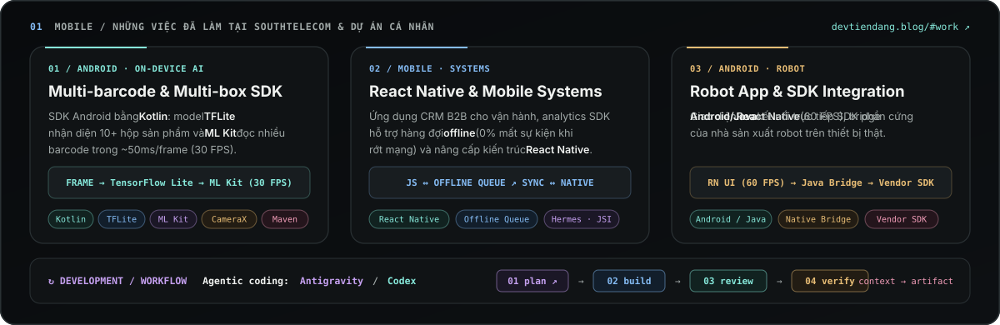

  
   
   
  

    
    
    
    
    
  

   
  

 

## `02` NGOÀI GIỜ LÀM / DỰ ÁN CÁ NHÂN

| Dự án | Kiến trúc & Dữ liệu | Trải nghiệm & Mã nguồn |
| :--- | :--- | :--- |
| **[devtiendang.blog & ChatDVT](https://devtiendang.blog)** `DISCORD / WEB / AWS EC2` | `01 Discord / Web` → `02 Event Handlers` → `03 Node.js + Prisma/SQLite` → `04 Gemini AI` Hệ sinh thái cá nhân gồm trang portfolio 4 tầng, cổng AI Chat trực tuyến, mini-game thời gian thực qua Socket.IO và bot Discord chạy 24/7. | [Mở devtiendang.blog ↗](https://devtiendang.blog) [Chat với ChatDVT ↗](https://devtiendang.blog/chat) [Khám phá Bot ↗](https://devtiendang.blog/discord) |
| **[TD-WallpaperEngine](https://devtiendang.blog/apps/td-wallpaperengine)** `WINDOWS 10/11 · C# / WPF` | `01 Local Media / URL` → `02 Library (C# / .NET 10 / WPF)` → `03 Image / mpv` → `04 Windows Desktop` Ứng dụng quản lý và phát hình nền video (MP4/WebM) độc lập không cần Steam, hỗ trợ tự đổi theo lịch, chỉnh 15/30/60 FPS và tự dừng khi mở app toàn màn hình. | [Xem trang ứng dụng ↗](https://devtiendang.blog/apps/td-wallpaperengine) [Tải bản cài đặt (.exe) ↗](https://github.com/tienDang0805/TD_WallpaperEngine/releases/latest) [Source Code ↗](https://github.com/tienDang0805/TD_WallpaperEngine) |

## `03` GHI CHÉP / PHÍA SAU NHỮNG DÒNG CODE ([devtiendang.blog/blog](https://devtiendang.blog/blog))

- **`AI · AGENT`** · [Giải ngố AI Agent, Code Harness và MCP — Vì sao cùng một model mà chỗ chạy khôn, chỗ chạy “lỏ”? ↗](https://devtiendang.blog/blog)
- **`AI · AGENT`** · [Mày mò đem Gemini 4 Argon (High) sang chạy trên OpenAI Codex — Khi hết tiền mua Plus nhưng chê Antigravity “lỏ” (Phần 2) ↗](https://devtiendang.blog/blog)
- **`KỂ CHUYỆN`** · [Vì sao một Mobile Dev lại đi làm bot? — Chuyện về ChatDVT (Phần 1) ↗](https://devtiendang.blog/blog)

## `04` LIÊN HỆ / SẴN SÀNG KẾT NỐI

- **01 // WEBSITE:** [https://devtiendang.blog](https://devtiendang.blog) — *Trang chủ, dự án, ứng dụng và ghi chép kỹ thuật*
- **02 // DIRECT EMAIL:** [dvtien8599@gmail.com](mailto:dvtien8599@gmail.com)
- **03 // NETWORK PRO:** [linkedin.com/in/đặng-văn-tiến](https://www.linkedin.com/in/%C4%91%E1%BA%B7ng-v%C4%83n-ti%E1%BA%BFn/)
- **04 // SOCIAL DIRECT:** [fb.com/dvtien8599](https://www.facebook.com/dvtien8599)
