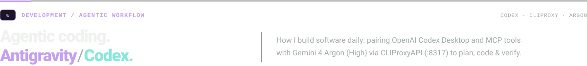
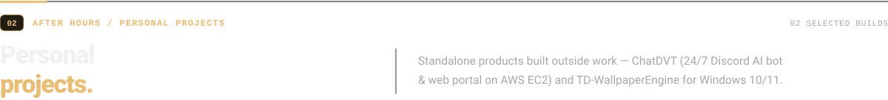
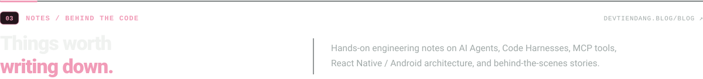
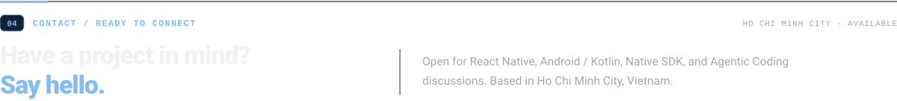

  

 

  

  <samp>01 // MY RUNNING STACK</samp> — <b>OpenAI Codex Desktop</b> paired with <b>MCP tools</b> (<code>apply_patch</code>, <code>exec_command</code>, <code>cua_repl</code>, <code>github</code>) routed through <code>CLIProxyAPI (127.0.0.1:8317)</code> to run <b>Gemini 4 Argon (High)</b>:

  

  <samp>02 // EXECUTION LOOP</samp> — Continuous <b>Plan → Build → Review → Verify</b> workflow with small verifiable diffs:

  <a href="https://devtiendang.blog/#agentic-flow">
     02 build -> 03 review -> 04 verify" />
  </a>

 

  

<h3>
  <samp>01 //</samp> <a href="https://devtiendang.blog">ChatDVT &amp; devtiendang.blog</a> &nbsp;<samp>DISCORD / WEB · AWS EC2</samp>
</h3>

  A 24/7 Discord AI bot and interactive web portal built with <b>TypeScript</b>, <b>discord.js</b>, <b>Node.js</b>, <b>Prisma/SQLite</b>, and <b>Socket.IO</b>, hosted on <b>AWS EC2</b>. Gemini handles multimodal AI chat, image/video analysis, summaries, and mini-games.
   
  <a href="https://devtiendang.blog"><b>Open devtiendang.blog ↗</b></a> &nbsp;·&nbsp; <a href="https://devtiendang.blog/chat"><b>Try web chat ↗</b></a> &nbsp;·&nbsp; <a href="https://devtiendang.blog/discord"><b>Explore the bot ↗</b></a>

  <a href="https://devtiendang.blog/discord">
     02 discord.js -> 03 ChatDVT (AWS EC2) -> 04 Gemini API" />
  </a>

 

<h3>
  <samp>02 //</samp> <a href="https://devtiendang.blog/apps/td-wallpaperengine">TD-WallpaperEngine</a> &nbsp;<samp>WINDOWS 10/11 · C# / .NET 10 / WPF</samp>
</h3>

  A standalone Windows desktop application for managing and playing animated video wallpapers (<b>MP4 / WebM</b>) via <b>mpv</b> without requiring Steam. Supports URL/YouTube imports, playlists, scheduled rotation, and 15/30/60 FPS caps.
   
  <a href="https://devtiendang.blog/apps/td-wallpaperengine"><b>Explore the app ↗</b></a> &nbsp;·&nbsp; <a href="https://github.com/tienDang0805/TD_WallpaperEngine/releases/latest"><b>Download installer (.exe) ↗</b></a> &nbsp;·&nbsp; <a href="https://github.com/tienDang0805/TD_WallpaperEngine"><b>Source code ↗</b></a>

  <a href="https://devtiendang.blog/apps/td-wallpaperengine">
     02 Library (C#/WPF) -> 03 Renderer (mpv) -> 04 Desktop" />
  </a>

 

  

<table>
  <tr>
    <td width="33.3%" valign="top">
      
<samp>01 // AI · AGENT</samp>

      
<a href="https://devtiendang.blog/blog"><b>Demystifying AI Agents, Code Harnesses &amp; MCP ↗</b></a>

      
Why the same LLM feels genius in one coding harness and clueless in another — explained with interactive 50 FPS diagrams.

    </td>
    <td width="33.3%" valign="top">
      
<samp>02 // AI · AGENT</samp>

      
<a href="https://devtiendang.blog/blog"><b>Running Gemini 4 Argon Inside OpenAI Codex via CLIProxyAPI ↗</b></a>

      
How I bridged Antigravity models into the OpenAI Codex desktop harness using a local proxy on port 8317.

    </td>
    <td width="33.3%" valign="top">
      
<samp>03 // STORYTELLING</samp>

      
<a href="https://devtiendang.blog/blog"><b>Why a Mobile Dev Built a 24/7 Discord Bot — ChatDVT ↗</b></a>

      
Behind the scenes of turning a group-chat joke into a cloud-hosted AI companion running on AWS EC2.

    </td>
  </tr>
</table>

  <a href="https://devtiendang.blog/blog"><b>Read all articles on devtiendang.blog/blog ↗</b></a>

 

  

<table>
  <tr>
    <td width="25%" valign="top">
      
<samp>01 // PORTFOLIO</samp>

      
<a href="https://devtiendang.blog"><b>devtiendang.blog ↗</b></a>

      
Interactive work, apps, playground &amp; technical blog

    </td>
    <td width="25%" valign="top">
      
<samp>02 // DIRECT EMAIL</samp>

      
<a href="mailto:dvtien8599@gmail.com"><b>dvtien8599@gmail.com ↗</b></a>

      
Direct inbox for mobile roles &amp; project inquiries

    </td>
    <td width="25%" valign="top">
      
<samp>03 // LINKEDIN</samp>

      
<a href="https://www.linkedin.com/in/%C4%91%E1%BA%B7ng-v%C4%83n-ti%E1%BA%BFn/"><b>in/đặng-văn-tiến ↗</b></a>

      
Professional background &amp; career network

    </td>
    <td width="25%" valign="top">
      
<samp>04 // FACEBOOK</samp>

      
<a href="https://www.facebook.com/dvtien8599"><b>fb.com/dvtien8599 ↗</b></a>

      
Quick direct message &amp; personal updates

    </td>
  </tr>
</table>
