  

 

  

<h2>
  Agentic Coding with Antigravity &amp; Codex
   
  <code>OpenAI Codex Desktop</code> · <code>MCP Harness</code> · <code>CLIProxyAPI :8317</code> · <code>Gemini 4 Argon (High)</code>
</h2>

> **Workflow Overview:** I pair **OpenAI Codex Desktop** with **MCP tools** (<kbd>apply_patch</kbd> <kbd>exec_command</kbd> <kbd>cua_repl</kbd> <kbd>github</kbd>) routed through a local **`CLIProxyAPI` (`127.0.0.1:8317`)** endpoint to run **Gemini 4 Argon (High)** in a continuous **Plan → Build → Review → Verify** loop.

  

  <a href="https://devtiendang.blog/#agentic-flow">
     02 build -> 03 review -> 04 verify" />
  </a>

 

  

<h2>
  Personal Projects &amp; System Architecture
   
  Standalone products built outside work — from a 24/7 cloud AI companion to a native Windows desktop engine.
</h2>

<table>
  <tr>
    <td width="68%" valign="middle">
      <h3>
        <kbd>01</kbd>&nbsp; <a href="https://devtiendang.blog">ChatDVT &amp; devtiendang.blog</a>
      </h3>
      

        A 24/7 Discord AI bot and interactive web portal hosted on <b>AWS EC2</b>. Powered by <b>Gemini</b> for multimodal chat, image/video analysis, live rooms, and mini-games.
      

      

        <kbd>TypeScript</kbd> <kbd>discord.js</kbd> <kbd>Node.js</kbd> <kbd>Prisma / SQLite</kbd> <kbd>Socket.IO</kbd> <kbd>AWS EC2</kbd>
      

    </td>
    <td width="32%" valign="middle" align="right">
        
      <a href="https://devtiendang.blog"><kbd> 🌐 Open devtiendang.blog ↗ </kbd></a>  
      <a href="https://devtiendang.blog/chat"><kbd> 💬 Try Web Chat ↗ </kbd></a>&nbsp;
      <a href="https://devtiendang.blog/discord"><kbd> 🤖 Bot Info ↗ </kbd></a>
    </td>
  </tr>
</table>

  <a href="https://devtiendang.blog/discord">
     02 discord.js -> 03 ChatDVT (AWS EC2) -> 04 Gemini API" />
  </a>

 

<table>
  <tr>
    <td width="68%" valign="middle">
      <h3>
        <kbd>02</kbd>&nbsp; <a href="https://devtiendang.blog/apps/td-wallpaperengine">TD-WallpaperEngine</a>
      </h3>
      

        A lightweight Windows 10/11 desktop app for managing and playing animated video wallpapers (<b>MP4 / WebM</b>) via <b>mpv</b> without requiring Steam. Supports URL/YouTube imports, playlists, and 15/30/60 FPS caps.
      

      

        <kbd>C#</kbd> <kbd>.NET 10</kbd> <kbd>WPF</kbd> <kbd>mpv Player</kbd> <kbd>Win32 WorkerW</kbd>
      

    </td>
    <td width="32%" valign="middle" align="right">
        
      <a href="https://github.com/tienDang0805/TD_WallpaperEngine/releases/latest"><kbd> ⬇ Download Installer (.exe) ↗ </kbd></a>  
      <a href="https://devtiendang.blog/apps/td-wallpaperengine"><kbd> 🖥 App Overview ↗ </kbd></a>&nbsp;
      <a href="https://github.com/tienDang0805/TD_WallpaperEngine"><kbd> 📦 Repo ↗ </kbd></a>
    </td>
  </tr>
</table>

  <a href="https://devtiendang.blog/apps/td-wallpaperengine">
     02 Library (C#/WPF) -> 03 Renderer (mpv) -> 04 Desktop" />
  </a>

 

  

<h2>
  Engineering Notes &amp; Deep Dives
   
  Hands-on technical articles on AI Agents, MCP Harnesses, Mobile Engineering, and product stories at <a href="https://devtiendang.blog/blog">devtiendang.blog/blog ↗</a>
</h2>

  <a href="https://devtiendang.blog/blog">
     50 FPS Diagrams -> Deep-Dive Notes -> devtiendang.blog/blog" />
  </a>

<table>
  <tr>
    <td width="33.3%" valign="top">
      

        
      

      <h4>
        <a href="https://devtiendang.blog/blog">Demystifying AI Agents, Code Harnesses &amp; MCP ↗</a>
      </h4>
      

        Why the same LLM feels genius in one coding harness and clueless in another — explained with interactive 50 FPS diagrams.
      

      

        <a href="https://devtiendang.blog/blog"><kbd> Read Article ↗ </kbd></a>
      

    </td>
    <td width="33.3%" valign="top">
      

        
      

      <h4>
        <a href="https://devtiendang.blog/blog">Running Gemini 4 Argon Inside OpenAI Codex via CLIProxyAPI ↗</a>
      </h4>
      

        How I bridged Antigravity models into the OpenAI Codex desktop harness using a local proxy on port <code>8317</code>.
      

      

        <a href="https://devtiendang.blog/blog"><kbd> Read Article ↗ </kbd></a>
      

    </td>
    <td width="33.3%" valign="top">
      

        
      

      <h4>
        <a href="https://devtiendang.blog/blog">Why a Mobile Dev Built a 24/7 Discord Bot — ChatDVT ↗</a>
      </h4>
      

        Behind the scenes of turning a group-chat joke into a cloud-hosted AI companion running on AWS EC2.
      

      

        <a href="https://devtiendang.blog/blog"><kbd> Read Article ↗ </kbd></a>
      

    </td>
  </tr>
</table>

 

  

<h2>
  Let's Build Something Together
   
  Have a <b>React Native</b>, <b>Android / Kotlin</b>, or <b>Agentic Coding</b> topic in mind? Reach out through any channel below.
</h2>

  

<table>
  <tr>
    <td width="25%" align="center" valign="top">
      
<kbd>01 // PORTFOLIO</kbd>

      
<a href="https://devtiendang.blog"><b>devtiendang.blog</b></a>

      
Interactive portfolio, apps, playground &amp; technical blog

      
<a href="https://devtiendang.blog"><kbd> 🌐 Visit Website ↗ </kbd></a>

    </td>
    <td width="25%" align="center" valign="top">
      
<kbd>02 // DIRECT EMAIL</kbd>

      
<a href="mailto:dvtien8599@gmail.com"><b>dvtien8599@gmail.com</b></a>

      
Direct inbox for mobile engineering &amp; project inquiries

      
<a href="mailto:dvtien8599@gmail.com"><kbd> ✉️ Send Email ↗ </kbd></a>

    </td>
    <td width="25%" align="center" valign="top">
      
<kbd>03 // LINKEDIN</kbd>

      
<a href="https://www.linkedin.com/in/%C4%91%E1%BA%B7ng-v%C4%83n-ti%E1%BA%BFn/"><b>Đặng Văn Tiến</b></a>

      
Professional background, career updates &amp; networking

      
<a href="https://www.linkedin.com/in/%C4%91%E1%BA%B7ng-v%C4%83n-ti%E1%BA%BFn/"><kbd> 💼 Connect ↗ </kbd></a>

    </td>
    <td width="25%" align="center" valign="top">
      
<kbd>04 // FACEBOOK</kbd>

      
<a href="https://www.facebook.com/dvtien8599"><b>fb.com/dvtien8599</b></a>

      
Quick direct message, community &amp; personal updates

      
<a href="https://www.facebook.com/dvtien8599"><kbd> 💬 Message ↗ </kbd></a>

    </td>
  </tr>
</table>
